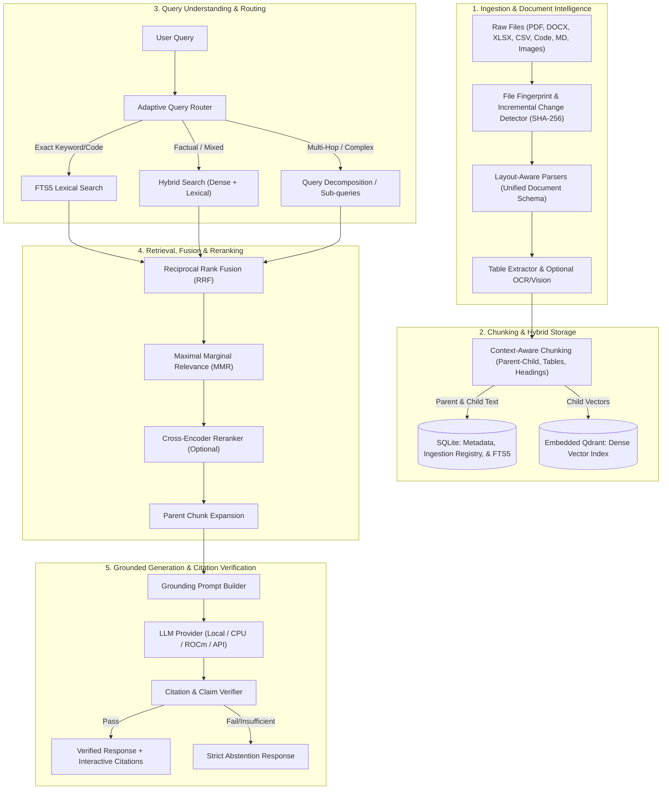

# Personal Advanced RAG Platform: System Architecture & Technical Specification

**Version:** 1.0.0  
**Status:** Approved for Implementation (Phase 1–8 CPU First)  
**Package Name:** `personal_rag`  

---

## 1. Architectural Philosophy

The Personal Advanced RAG Platform is designed as an extensible, local-first, privacy-respecting research and document intelligence system. Unlike ephemeral contest submissions, it adheres to these core tenets:

1. **Hardware Agnostic & Zero-Cost Default:** Operates fully on CPU using standard Python libraries, lightweight local embeddings, and deterministic test fixtures. GPU acceleration (ROCm / CUDA) and external API providers are pluggable options, never hard requirements.
2. **Defensive Grounding & Non-Negotiable Attributions:** Every response is explicitly anchored to verifiable passages. If evidence is ambiguous or missing, the system abstains cleanly rather than hallucinating.
3. **Adaptive Query Routing:** Replaces rigid one-size-fits-all retrieval with a query classifier that routes queries according to informational intent (Exact Identifiers, Semantic Discovery, Multi-Hop Synthesis, Structural/Table Analysis).
4. **Local Data Sovereignty:** Private documents never leave the local environment unless an external model provider is explicitly configured and enabled by the user.

---

## 2. End-to-End System Data Flow



---

## 3. Detailed Component Specifications

### 3.1 Document Ingestion & Parsers (`personal_rag.parsers`)
* **Unified Output Contract:** Every parser returns a `ParsedDocument` object containing:
  * `document_id`: Stable SHA-256 hash of raw file bytes.
  * `title`: Extracted or filename-derived title.
  * `source_path`: Normalized relative source path.
  * `mime_type`: Standard MIME type string.
  * `pages`: List of `ParsedPage` (page number, raw text, tables, images).
  * `tables`: List of `ExtractedTable` (reconstructed Markdown tables + column headers).
  * `metadata`: File size, timestamps, creation dates, parser warnings.
* **Specialized Parsers:**
  * **PDF:** `PyMuPDFParser` (text layout, embedded image blocks, table coordinate bounding).
  * **Word:** `DocxParser` (paragraphs, headings hierarchy, inline table extraction).
  * **Spreadsheets:** `XlsxCsvParser` (multi-sheet traversal, markdown table conversion).
  * **Markdown / Plaintext / Code:** `CodeTextParser` (syntax preservation, AST/function boundaries).

### 3.2 Advanced Chunking Engine (`personal_rag.chunking`)
* **Parent-Child Hierarchy:**
  * **Parent Chunks:** 1,200–2,000 characters capturing complete sections, full table contexts, or code functions.
  * **Child Chunks:** 300–500 characters containing granular facts, part numbers, or sentences.
  * **Mechanism:** Dense and lexical search index the child chunks; during generation, the parent chunk is retrieved to provide broad context without token window explosion.
* **Table-Aware Chunking:** Never truncates table rows mid-line; prepends table column headers to every segmented table chunk.

### 3.3 Hybrid Storage Engine (`personal_rag.storage`)
* **Local-First SQLite Engine:**
  * Manages `documents`, `chunks`, `conversations`, and `user_memory` tables.
  * Houses **SQLite FTS5 virtual tables** with BM25 ranking for instantaneous, zero-RAM lexical searches.
* **Embedded Qdrant Vector Store:**
  * Uses `qdrant-client` in embedded local mode (`path="./data/qdrant"`).
  * No external daemon, server port, or container required.
  * Stores embeddings with cosine distance and full payload filtering (`doc_id`, `tags`, `is_parent`, `created_at`).

### 3.4 Hybrid Retrieval & Query Routing (`personal_rag.retrieval`)
* **Reciprocal Rank Fusion (RRF):**
  $$\text{RRF\_Score}(d) = \sum_{m \in M} \frac{w_m}{k + \text{rank}_m(d)}$$
  Where $k=60$, and $w_m$ weights dense vs. lexical retrieval according to query routing classification.
* **Adaptive Query Classification:**
  * **Lookup Intent:** High lexical weight ($w_{\text{lex}} = 0.85$, $w_{\text{dense}} = 0.15$).
  * **Exploratory / Conceptual Intent:** High dense weight ($w_{\text{dense}} = 0.8$, $w_{\text{lex}} = 0.2$).
  * **Comparative / Multi-Hop:** Triggers iterative retrieval across entity links.

### 3.5 Generation & Model Providers (`personal_rag.generation`)
* **Pluggable Model Provider Protocol:**
  * `BaseModelProvider` abstract class with methods `generate(prompt, context, **kwargs)`.
  * **Implemented Providers:**
    * `MockProvider` (deterministic, zero compute, for 100% CPU unit and integration tests).
    * `LocalTransformersProvider` (CPU / CUDA / ROCm via Hugging Face).
    * `OpenAICompatibleProvider` (vLLM, Ollama, LM Studio, or remote cloud endpoints).
* **Strict Abstention Guarantee:**
  * When context similarity scores fall below confidence threshold $\tau_{\text{abstain}}$, the engine returns:
    `"The knowledge base does not contain sufficient verified evidence to answer this question."`
  * Zero hallucinations or invented citations.

### 3.6 Citation Verification Engine (`personal_rag.citations`)
* Extracts cited chunk IDs from LLM output.
* Verifies:
  1. Does the cited chunk ID exist in the retrieval set?
  2. Does the chunk text contain the factual claim / entity?
  3. Are all cited files strictly necessary (necessity test)?
* Strips non-contributing citations and displays exact source paths, page numbers, and supporting excerpts.

---

## 4. Security & Privacy Safeguards

1. **Untrusted Document Boundary:** Document text is injected into prompt templates wrapped in strict XML boundary tags (`<untrusted_document_context>`), with system prompts instructing the LLM to ignore embedded commands, prompt injections, or system instruction overrides.
2. **Localhost Binding:** FastAPI backend and Streamlit UI bind exclusively to `127.0.0.1`.
3. **Safe File Handling:** Path traversal defenses (`os.path.commonpath`) prevent access outside designated data directories.

---

## 5. Directory Layout

```
personal_rag/
├── pyproject.toml
├── README.md
├── .env.example
├── data/                       (Git-ignored)
│   ├── documents/
│   ├── qdrant/
│   └── knowledge_base.db
├── src/personal_rag/
│   ├── __init__.py
│   ├── api/                    # FastAPI server
│   ├── core/                   # Config, logging, device manager
│   ├── parsers/                # Document parsers
│   ├── chunking/               # Context-aware chunkers
│   ├── storage/                # SQLite FTS5 & Qdrant integration
│   ├── embeddings/             # Embedding provider abstractions
│   ├── retrieval/              # Hybrid search, RRF, MMR, Router
│   ├── reranking/              # Cross-encoders
│   ├── generation/             # LLM provider abstractions
│   ├── citations/              # Grounding & citation verifier
│   ├── memory/                 # Conversational memory
│   └── ui/                     # Streamlit dashboard
└── tests/
    ├── unit/                   # Fast CPU unit tests
    └── fixtures/               # Synthetic documents & questions
```

