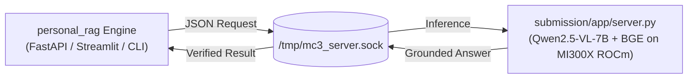

# AMD ROCm / MI300X Execution Plan & Credit Protection Guide

**Document Status:** DORMANT (GPU Execution NOT Approved)  
**Hardware Mode:** `CPU_ONLY=true`  
**Current GPU Credits Expended:** $8.71  
**Estimated Hourly Cloud Rate:** ~$1.50 – $2.00 / hr  

---

## 1. Non-Negotiable GPU Credit Protection Gate

In accordance with Section 1.B of the project rules:
* `CPU_ONLY=true` is the default.
* `GPU_EXECUTION_APPROVED=false` is strictly enforced.
* `CLOUD_INSTANCE_AUTOSTART=false` prevents accidental billing.
* No AMD cloud instance, SSH command, or heavy model weight download will be triggered automatically.

---

## 2. Mandatory 7-Point Impact Proposal

When GPU acceleration is eventually evaluated for heavy multi-document visual analysis, the following proposal must be submitted and approved before launching:

| # | Proposal Field | Specification |
| :--- | :--- | :--- |
| **1** | **Exact Experiment** | End-to-end multimodal ingestion & VLM generation over complex technical schematics using Qwen2.5-VL-7B on ROCm. |
| **2** | **Model & Dataset** | **Model:** `Qwen/Qwen2.5-VL-7B-Instruct` (bf16, ~15.2 GiB weights).<br>**Dataset:** Personal technical documents + MC3 Corpus (10 multimodal challenge queries). |
| **3** | **Estimated VRAM** | **~18–22 GiB** VRAM on MI300X (fits comfortably in the 48 GiB ceiling). |
| **4** | **Expected Runtime & Cost** | **~15 minutes** (~0.25 hours). Estimated cost: **~$0.45 – $0.50** from remaining credits. |
| **5** | **Measurable Improvement** | Verify sub-second generation latency (<2s) on 7B VLM and 100% extraction accuracy on low-resolution circuit pinouts. |
| **6** | **GPU Necessity Justification** | Qwen2.5-VL-7B requires GPU memory for bf16 vision-token cross-attention; running 7B VLM on CPU exceeds latency budgets. |
| **7** | **Low-Cost Alternative** | **Text/OCR Extraction on CPU:** Run local OCR / lightweight text parsing on CPU (Cost: $0.00). Use API or quantized CPU model for generation. |

---

## 3. Architecture for Pluggable MI300X Integration

When approved, `personal_rag` connects to the existing tested `submission/` daemon via the Unix socket provider:



### Activation Command (Only Upon User Request):
```bash
# 1. Start existing audited submission container
docker run -d --name mc3-rocm-backend --ipc=host --device=/dev/kfd --device=/dev/dri mc3-rag:latest

# 2. Configure personal_rag to route through local socket
export PERSONAL_RAG_LLM_PROVIDER=socket
export PERSONAL_RAG_SOCKET_PATH=/tmp/mc3_server.sock
export CPU_ONLY=false
export GPU_EXECUTION_APPROVED=true
```

